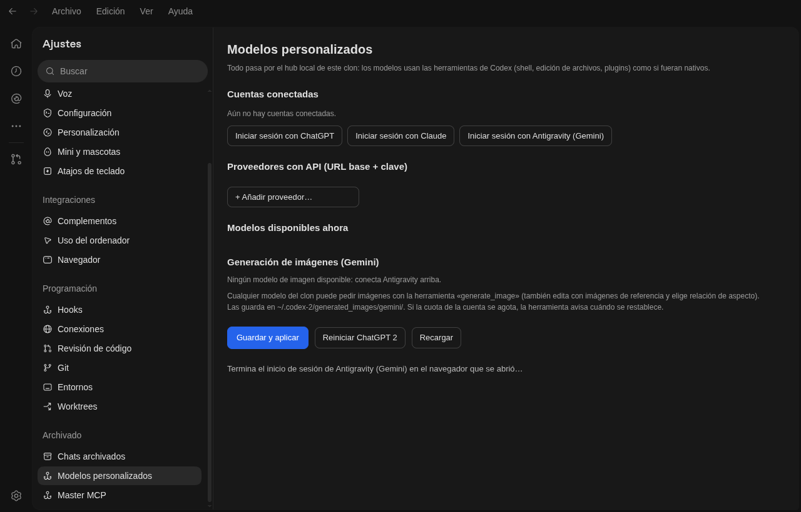
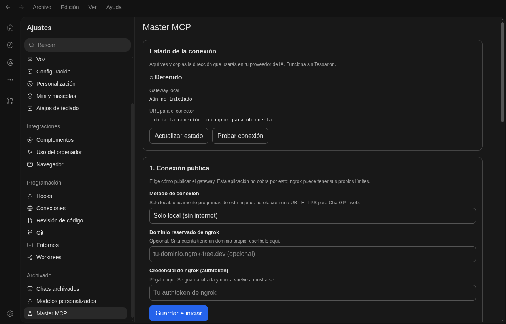

<div align="center">

# ChatGPT 2 para Linux

**La app de escritorio de ChatGPT/Codex de OpenAI, con tus propios modelos dentro.**
Conecta Antigravity (Gemini), Claude, ChatGPT o cualquier API compatible con OpenAI y úsalos con las herramientas nativas de Codex: terminal, edición de archivos, plugins, agentes.

`Linux x86_64` · `instalación en tu carpeta de usuario` · `no toca tu Codex normal` · `sin root`

</div>

---

## Índice

1. [¿Qué es esto?](#qué-es-esto)
2. [Qué incluye y qué hace cada pieza](#qué-incluye-y-qué-hace-cada-pieza)
3. [Requisitos](#requisitos)
4. [Instalación](#instalación)
5. [Primer inicio (inicio de sesión)](#primer-inicio-inicio-de-sesión)
6. [Tutorial: conectar tus modelos](#tutorial-conectar-tus-modelos)
   - [Modo AUTO](#modo-auto-cambia-de-modelo-solo)
7. [Modo «ChatGPT Web»](#modo-chatgpt-web)
8. [Master MCP](#master-mcp)
9. [Generación de imágenes](#generación-de-imágenes)
10. [Actualizar y desinstalar](#actualizar-y-desinstalar)
11. [Solución de problemas](#solución-de-problemas)
12. [Seguridad y privacidad](#seguridad-y-privacidad)
13. [Estructura del repositorio](#estructura-del-repositorio)
14. [Cómo funciona por dentro](#cómo-funciona-por-dentro)
15. [Probado en](#probado-en)
16. [Aviso legal](#aviso-legal)

---

## ¿Qué es esto?

OpenAI publica una app de escritorio oficial para Linux (ChatGPT + Codex). Solo habla con los modelos de OpenAI.

Este proyecto **instala una segunda copia** de esa app, aparte de la tuya, y le añade:

- **Modelos personalizados.** Una sección nueva en Ajustes para iniciar sesión con Antigravity, Claude o ChatGPT, o para añadir cualquier proveedor con URL base y clave. Los modelos aparecen en el selector de Codex y funcionan con **todas** sus herramientas, como si fueran nativos.
- **Modo «ChatGPT Web».** El modo «ChatGPT Work» del selector se sustituye por tu sesión real de chatgpt.com dentro de la app, con el mismo color y sin paneles duplicados.
- **Master MCP.** Un servidor MCP local (carpetas de trabajo y navegador) que puedes conectar a ChatGPT web.
- **Generación de imágenes con Gemini.** Una herramienta `generate_image` disponible para cualquier modelo.

Todo corre en tu máquina. Tu ChatGPT/Codex de siempre **no se toca**: la copia usa otro comando (`chatgpt2`), otras carpetas de datos y su propio perfil.



> **Qué NO es.** No es un producto de OpenAI ni está afiliado a OpenAI, Google o Anthropic. Este repositorio **no contiene ni redistribuye** ningún archivo de OpenAI: el instalador descarga la app desde el servidor oficial de OpenAI y le aplica los parches en tu equipo. Ver [Aviso legal](#aviso-legal).

---

## Qué incluye y qué hace cada pieza

| Pieza | Qué hace | Dónde vive |
|---|---|---|
| **App de OpenAI** (descargada) | La app oficial de ChatGPT/Codex para Linux, versión fijada y verificada con SHA-256. | `~/.local/opt/chatgpt2/` |
| **`patch_ui.py`** | Extrae el `app.asar` original, le añade las pantallas y parches de abajo y lo vuelve a empaquetar. Parte siempre del original, así que se puede repetir sin acumular cambios. | `modelhub/patch_ui.py` |
| **ModelHub** (`:8318`) | Servicio local. Guarda tus proveedores y cuentas, escribe la configuración del proxy, genera el catálogo de modelos de Codex y lanza los inicios de sesión OAuth. Exige un token y rechaza orígenes ajenos. | `modelhub/modelhub.py` |
| **CLIProxyAPI** (`:8317`) | Proxy de código abierto ([router-for-me/CLIProxyAPI](https://github.com/router-for-me/CLIProxyAPI)). Habla con Antigravity, Claude y ChatGPT mediante OAuth y expone todo como una API compatible con OpenAI. | `cliproxyapi/cli-proxy-api` |
| **Enrutador AUTO** (`:8320`) | Vive dentro de ModelHub. Cuando eliges modelos para AUTO, Codex habla con él en vez de con el proxy: reenvía todo tal cual y, si la petición es para `auto`, prueba tus modelos por orden y pasa al siguiente cuando uno falla. | `modelhub/modelhub.py` |
| **Pantalla «Modelos personalizados»** | La interfaz de Ajustes para conectar cuentas, añadir proveedores y aplicar cambios. | `modelhub/custom-models-settings.js` |
| **Pestaña «ChatGPT Web»** (`:8322`) | Una vista nativa de chatgpt.com dentro de la ventana, con sesión persistente propia, mismo color que la app y un menú de modos que se abre por encima de la web. **No automatiza ni lee la página.** | `modelhub/chatgpt_web_view.js` y `chatgpt_web_overlay.js` |
| **Master MCP** (`:8319`) | Servidor MCP local con herramientas de carpetas y navegador, protegido con OAuth. Apagado por defecto. | `mastermcp/` |
| **`gemini_media_mcp.py`** | Servidor MCP que da `generate_image` a cualquier modelo usando las cuentas de Antigravity. | `modelhub/gemini_media_mcp.py` |
| **Lanzador `chatgpt2`** | Levanta lo que falte (proxy, hub, Master MCP) y abre la app con su propio perfil. | `bin/chatgpt2` |

Los puertos (8317, 8318, 8319, 8320 y 8322) escuchan **solo en `127.0.0.1`**.

---

## Requisitos

- **Linux de 64 bits** (x86_64). arm64 está soportado en el instalador, pero no está probado.
- Entorno gráfico (X11 o Wayland).
- Unos **3 GB libres** (app extraída ~1.6 GB, copia limpia del original ~0.5 GB, caché de descarga ~0.5 GB).
- Internet para la instalación.

No hace falta instalar nada antes: **el instalador detecta tu distro y añade lo que falte** (`curl`, `python3`, `node`, `xz`, `ar` y las librerías gráficas de Electron). Soporta `apt` (Ubuntu, Debian y derivadas), `dnf` (Fedora), `pacman` (Arch y derivadas) y `zypper` (openSUSE). Si necesita instalar paquetes, usa `sudo` y te pedirá tu contraseña.

---

## Instalación

### Opción A · clonar el repositorio (recomendada)

```bash
git clone https://github.com/tuangel134/chatgpt2-linux.git
cd chatgpt2-linux
./install.sh
```

### Opción B · una sola línea

```bash
curl -fsSL https://raw.githubusercontent.com/tuangel134/chatgpt2-linux/main/install.sh | bash
```

> Si prefieres revisar el script antes de ejecutarlo (es lo sensato), usa la opción A y léelo: tiene comentarios al inicio de cada paso.

### Qué hace el instalador, paso a paso

1. **Comprueba el sistema** (Linux, arquitectura, gestor de paquetes). Se niega a ejecutarse como root.
2. **Instala las herramientas básicas** que falten.
3. **Descarga la app oficial** (`.deb`, ~450 MB) desde `persistent.oaistatic.com` y comprueba su **SHA-256**. Si no coincide, borra la descarga y se detiene.
4. **La extrae sin instalarla**: abre el `.deb` con `ar` y `tar`. No usa `dpkg`, no añade repositorios de apt y no toca el sistema.
5. **Instala las librerías de Electron** que falten (en Debian/Ubuntu lee la lista de dependencias del propio `.deb`) y lo comprueba con `ldd`.
6. **Copia la app** a `~/.local/opt/chatgpt2` y guarda una copia limpia del `app.asar` como `app.asar.orig`.
7. **Descarga CLIProxyAPI** de sus *releases* oficiales y verifica su SHA-256 con el `checksums.txt` publicado.
8. **Inicializa el hub** (genera tu clave local y tu token) y **aplica los parches** a la interfaz.
9. **Crea el comando** `~/.local/bin/chatgpt2` y el acceso **«ChatGPT 2»** en el menú de aplicaciones.

Si algo falla, te lo dice con el motivo. Puedes volver a ejecutarlo las veces que quieras: es idempotente.

### Opciones

| Opción | Efecto |
|---|---|
| `--prefix DIR` | Instala en otra carpeta (por defecto `~/.local/opt/chatgpt2`). |
| `--deb ARCHIVO` | Usa un `.deb` que ya tengas (sin verificación de hash). |
| `--version X.Y.Z` | Otra versión de la app de OpenAI. Los parches están hechos para la versión probada (`26.930.31730`); con otra pueden no encajar y la app se instalaría sin parches. |
| `--skip-deps` | No instala nada del sistema, solo comprueba. |
| `--no-menu` | No crea el acceso en el menú de aplicaciones. |
| `--yes` | No pregunta nada. |

Variables útiles: `CHATGPT2_HOME` (carpeta de la app), `CODEX_HOME` (datos, por defecto `~/.codex-2`).

---

## Primer inicio (inicio de sesión)

Abre **ChatGPT 2** desde el menú o ejecuta:

```bash
chatgpt2
```

La app de OpenAI pide iniciar sesión la primera vez. Tienes dos caminos:

**Camino 1 · con tu cuenta de ChatGPT.** Pulsa *Continuar para iniciar sesión* y entra en el navegador. Es el inicio de sesión normal de la app de OpenAI.

**Camino 2 · sin cuenta de ChatGPT (solo modelos del hub).** Cierra la app y ejecuta una vez:

```bash
chatgpt2 --local-login
```

Esto registra la clave local del hub (`sk-local-…`, solo válida en tu equipo) como credencial de la app. Al abrirla ya no te pide nada y puedes conectar tus modelos en el hub. Es el camino adecuado si solo quieres usar Antigravity, Claude u otras APIs. El modo **ChatGPT Web** no depende de este paso: tiene su propio inicio de sesión en chatgpt.com dentro de la pestaña.

> La clave local no sale de tu máquina: es la que protege el proxy en `127.0.0.1:8317`.

---

## Tutorial: conectar tus modelos

Todo se hace desde la propia app: **Ajustes → Modelos personalizados**.

### 1. Conectar una cuenta (Antigravity, Claude o ChatGPT)

1. Abre **Ajustes → Modelos personalizados**.
2. En **Cuentas conectadas** pulsa el botón del servicio: *Iniciar sesión con Antigravity (Gemini)*, *…con Claude* o *…con ChatGPT*.
3. Se abre tu navegador con la pantalla de inicio de sesión del servicio. Entra con **tu** cuenta y acepta.
4. Vuelve a la app: la cuenta aparece en la lista. Las credenciales quedan en `~/.cli-proxy-api/` (solo tu usuario).
5. Pulsa **Guardar y aplicar**. Los modelos de esa cuenta aparecen en *Modelos disponibles ahora*.

Puedes conectar varias cuentas del mismo servicio; la cuota de cada modelo es la de **tu** cuenta.

### 2. Añadir un proveedor con API (URL base + clave)

Sirve para cualquier servicio compatible con la API de OpenAI (OpenRouter, un servidor propio, LM Studio, vLLM, Ollama con compatibilidad OpenAI…).

1. En **Proveedores con API** pulsa **+ Añadir proveedor…**.
2. Rellena:
   - **Nombre**: el que quieras ver como sufijo del modelo.
   - **URL base**: por ejemplo `https://openrouter.ai/api/v1`.
   - **Clave API**: la tuya. Se guarda con permisos `0600` y la pantalla solo vuelve a mostrar los últimos 4 caracteres.
   - **Modelos**: nombre del modelo, alias opcional, nombre visible, contexto y si acepta imágenes.
3. **Guardar y aplicar**.

### 3. Usar los modelos

1. Pulsa **Reiniciar ChatGPT 2** (o ciérrala y ábrela de nuevo) para que Codex lea el catálogo nuevo.
2. Abre una conversación y elige el modelo en el selector. Verás nombres como *Gemini 3.1 Pro (Antigravity)* o *Claude … (Claude)*.
3. Trabaja como siempre: el modelo puede ejecutar comandos, editar archivos y usar plugins con las herramientas nativas de Codex.

> Mientras no haya ningún modelo conectado, el proveedor del hub queda **desactivado** a propósito (Codex rechaza un catálogo vacío). Se activa solo cuando aparece el primero.

### 4. Quitar una cuenta o un proveedor

En la misma pantalla: **Quitar** junto a la cuenta, o **Quitar proveedor** en el proveedor, y luego **Guardar y aplicar**.

### Modo AUTO: cambia de modelo solo

AUTO es un modelo más en el selector de Codex (aparece el primero de la lista). Tú eliges **qué modelos entran y en qué orden**; AUTO usa el primero y, **si falla o se queda sin cuota o límite, pasa solo al siguiente**.

1. Abre **Ajustes → Modelos personalizados** y baja hasta **AUTO · cambia de modelo solo**.
2. Pulsa **+ Añadir modelo a AUTO…** y elige un modelo. Repite con los que quieras.
3. Ordénalos con **▲ ▼** (el 1 es el preferido) y quita con **✕**.
4. **Guardar y aplicar** y luego **Reiniciar ChatGPT 2**.
5. En el selector de modelos de Codex elige **AUTO**.

Debajo de la lista ves cuál fue el último modelo usado y cuáles se saltó (por ejemplo: *«saltó: nemotron-3.5-lightning-free (HTTP 401)»*).

**Cómo decide:**

- Cambia de modelo con estos fallos: sin cuota o límite (429), sin acceso o sesión caducada (401, 402, 403), modelo no encontrado (404), tiempo agotado (408), errores del servidor (5xx) y sin conexión.
- Un modelo que falla se **salta durante unos minutos** (5 minutos por defecto, 10 si el modelo no existe, 1 para errores de servidor; si el servicio manda `Retry-After`, se respeta) y se vuelve a probar después, así que el primero de tu lista recupera su puesto.
- Si todos fallan, devuelve el error del último.
- Si dejas la lista vacía, AUTO desaparece del selector (el enrutador sigue activo para el resto de modelos).

**Límites (importante):**

- Solo cambia **antes** de que el modelo empiece a responder. Si un modelo falla a mitad de una respuesta, esa respuesta falla; no se retoma con otro.
- Al cambiar de modelo se **descarta el razonamiento cifrado** de los turnos anteriores, porque no vale para otro modelo. El resto de la conversación sí se conserva.
- El contexto de AUTO es el del modelo más pequeño de tu lista, y acepta imágenes solo si todos los modelos las aceptan.
- Los niveles de razonamiento de AUTO son los comunes: bajo, medio y alto.

---

## Modo «ChatGPT Web»

El selector de modos (arriba a la izquierda) tiene **Codex** y **ChatGPT Web**.

- En **Codex** ves todo: paneles, proyectos, hilos.
- En **ChatGPT Web** la ventana muestra **chatgpt.com real** con tu sesión. Se conserva solo el encabezado (selector de modos, campana y búsqueda).
- La sesión es **persistente** y vive en una partición propia dentro de `~/.config/Codex-2`, separada de todo lo demás.
- Al abrir el selector de modos, el menú se dibuja **encima** de la web: la app toma una foto de la página, la deja de fondo y retira la vista un instante. Al cerrarlo, la web vuelve.
- La página usa el mismo gris que la app para que no se note el corte.

> **Decisión de diseño importante.** Esta pestaña **solo muestra** la página. No lee, no automatiza y no extrae nada de chatgpt.com. Los términos de OpenAI prohíben la extracción automática y pueden suspender cuentas; por eso este proyecto no incluye (ni incluirá) ningún puente que controle la web.

Como la web ocupa el área, el **botón de Ajustes** (abajo a la izquierda) queda tapado en este modo: cambia a Codex para abrir Ajustes.

---

## Master MCP

Un servidor MCP **local** que puedes conectar a ChatGPT web para que trabaje sobre tus carpetas o tu navegador. Está **apagado por defecto**.

1. **Ajustes → Master MCP**.
2. Añade al menos una **carpeta autorizada** (se abre un selector: usa `kdialog` o `zenity`).
3. Elige los permisos. Los peligrosos (host, SSH, Docker, sudo, dispositivos) vienen desactivados.
4. Elige **Solo local** (sin internet) o **ngrok** si quieres exponerlo a ChatGPT web. Para ngrok necesitas tu propio *authtoken* y el SDK (`npm install @ngrok/ngrok` dentro de `~/.local/opt/chatgpt2/mastermcp`).
5. El registro usa OAuth con PKCE: nada se concede solo; tú apruebas qué carpeta y qué permisos.

Las acciones de navegador usan un Chromium propio (busca `brave`, `chromium`, `google-chrome`, `microsoft-edge`; se puede forzar con `CHATGPT2_BROWSER=/ruta`) con un perfil separado.

Requiere `node` 18 o superior; si no lo hay, el instalador lo deja desactivado y te avisa.



---

## Generación de imágenes

Cuando tienes una cuenta de **Antigravity** conectada, todos los modelos del clon ganan la herramienta `generate_image` (texto → imagen, y edición con imágenes de referencia). Las imágenes se guardan en `~/.codex-2/generated_images/gemini/`. Si la cuota de la cuenta se agota, la herramienta te dice cuándo se restablece.

---

## Actualizar y desinstalar

**Actualizar este proyecto:**

```bash
cd chatgpt2-linux && git pull && ./install.sh
```

**Si OpenAI actualiza su app**, los parches (que dependen del código exacto de la versión fijada) pueden dejar de encajar. Por eso el instalador baja siempre la versión probada. Para probar otra, usa `--version`; si los parches no encajan, el instalador lo avisa y deja la app sin parches en vez de romperla.

**Desinstalar** (conserva tus datos):

```bash
./uninstall.sh
```

**Desinstalar y borrar todo** (cuentas conectadas, chats y caché):

```bash
./uninstall.sh --purge
```

---

## Solución de problemas

**La app no abre en Ubuntu 24.04 / sistemas con AppArmor restrictivo.**
Esos sistemas limitan los *user namespaces* que usa el sandbox de Electron. Prueba:

```bash
CHATGPT2_FLAGS="--no-sandbox" chatgpt2
```

**Falta alguna librería (`error while loading shared libraries`).**
El instalador lo comprueba con `ldd` y lista lo que falte. Instálalo con tu gestor de paquetes y vuelve a ejecutar `./install.sh`.

**«Los parches NO encajaron».**
Estás usando una versión de la app distinta a la probada. Vuelve a ejecutar sin `--version`.

**Un puerto está ocupado (8317, 8318, 8319, 8320 o 8322).**
Los puertos son fijos. Cierra lo que los use o la otra instancia de ChatGPT 2: `pkill -f 'user-data-dir=.*Codex-2'`.

**El inicio de sesión de Antigravity/Claude no abre el navegador.**
Mira el registro: `/tmp/modelhub-login-antigravity.log` (aparece la URL de inicio de sesión; ábrela a mano).

**«invalid compaction capsule: unrecognized compaction capsule format».**
Una conversación antigua trae un resumen (compactación) cifrado por otro proveedor o versión, y el proxy no sabe leerlo. El enrutador local lo detecta, descarta esa cápsula y reintenta la petición con un aviso de que se perdió ese resumen; no hace falta hacer nada. Si ves el error, comprueba que ChatGPT 2 se reinició tras actualizar (`base_url` del hub en `~/.codex-2/config.toml` debe ser `http://127.0.0.1:8320/v1`).

**Los modelos no aparecen tras conectar la cuenta.**
Pulsa *Guardar y aplicar* y luego *Reiniciar ChatGPT 2*. Registro del proxy: `~/.codex-2/cliproxyapi.log`.

**Quiero depurar la interfaz.**
`CHATGPT2_FLAGS="--remote-debugging-port=9333" chatgpt2` (déjalo apagado en el uso normal: cualquier programa local podría controlar la app).

---

## Seguridad y privacidad

- Todo escucha **solo en `127.0.0.1`**. Nada se expone a la red salvo que actives ngrok en Master MCP.
- Los servicios locales exigen **token** y solo aceptan peticiones de la propia app (`app://-`). Los tokens se generan en tu equipo y se guardan con permisos `0600`.
- Las **cuentas y claves** quedan en tu carpeta de usuario (`~/.cli-proxy-api`, `~/.codex-2`) y **no se suben ni se comparten**: este repositorio no contiene credenciales.
- El `app.asar` parcheado incrusta el token local de tu equipo, por eso se instala con permisos `0600`.
- La depuración remota de Electron está **desactivada** por defecto.
- El instalador verifica con **SHA-256** la app de OpenAI y CLIProxyAPI antes de usarlos.
- La pestaña ChatGPT Web usa una partición separada, sin acceso a tus otros datos, y no inyecta scripts en la página (solo ajusta colores con CSS).

---

## Estructura del repositorio

```
chatgpt2-linux/
├── install.sh              instalador adaptable (detecta distro e instala lo que falte)
├── uninstall.sh            desinstalador (--purge borra también los datos)
├── bin/chatgpt2            lanzador: levanta proxy, hub y Master MCP, y abre la app
├── modelhub/
│   ├── patch_ui.py         extrae app.asar.orig → parchea → reempaqueta
│   ├── asar_tools.py       lector/empaquetador de .asar sin dependencias
│   ├── modelhub.py         servicio local de modelos y cuentas (:8318)
│   ├── custom-models-settings.js   pantalla «Modelos personalizados»
│   ├── master-mcp-settings.js      pantalla «Master MCP»
│   ├── chatgpt_web_view.js         proceso principal: vista de chatgpt.com (:8322)
│   ├── chatgpt_web_overlay.js      interfaz: posición, cubierta y menú sobre la web
│   ├── gemini_media_mcp.py         herramienta generate_image
│   ├── tests/test_auto_router.py   pruebas del enrutador AUTO (proxy falso, sin cuentas)
│   └── restart-clone.sh            botón «Reiniciar» de Ajustes
├── mastermcp/              Master MCP (host.cjs compilado + fuentes TypeScript + pruebas)
└── docs/img/               capturas
```

---

## Cómo funciona por dentro

1. La app de OpenAI es un Electron cuya interfaz vive en un `app.asar` con código minificado.
2. `patch_ui.py` **extrae el `app.asar.orig`**, localiza puntos concretos (lista de secciones de Ajustes, rutas, títulos, el selector de modos) y los modifica con sustituciones **exactas**: cada una exige exactamente una coincidencia y, si no la hay, aborta. Luego añade las páginas nuevas y reempaqueta conservando los ficheros marcados como *unpacked*.
3. El hub escribe `~/.codex-2/config.toml` con un proveedor `hub` que apunta al proxy y un `hub-models.json` con el catálogo; Codex lo lee como si fuera su catálogo oficial.
4. CLIProxyAPI traduce cada petición al servicio real (Antigravity, Claude, ChatGPT…) usando tus credenciales OAuth.
5. La pestaña **ChatGPT Web** es una `WebContentsView` añadida a la ventana principal desde el proceso principal. El renderizador le indica por un canal local con token dónde colocarse; al abrirse un menú, pide una foto de la vista, la pone de fondo y la retira un momento.

Por eso los parches están ligados a una versión: el código minificado cambia en cada compilación.

---

## Probado en

| Sistema | Instalador | Librerías | Arranque de la app |
|---|---|---|---|
| CachyOS (Arch), instalación limpia con `HOME` vacío | ✅ | ✅ | ✅ |
| Ubuntu 24.04 (contenedor, con `--no-sandbox` y pantalla virtual) | ✅ | ✅ | ✅ (los 4 servicios arrancan) |
| Debian 13 (contenedor) | ✅ | ✅ | no probado |
| Fedora 43 (contenedor) | ✅ | ✅ | no probado |
| Arch Linux (contenedor) | ✅ | ✅ | no probado |

Versión de la app de OpenAI: **26.930.31730**. Versión de CLIProxyAPI: **8.0.33**.

Lo que no se pudo probar sin cuentas reales: el inicio de sesión de cada servicio (Antigravity, Claude, ChatGPT) y las respuestas de los modelos. Eso depende de tus cuentas.

---

## Aviso legal

- Proyecto **no oficial**, sin relación con OpenAI, Google ni Anthropic. «ChatGPT», «Codex», «OpenAI», «Gemini», «Antigravity» y «Claude» son marcas de sus dueños.
- El repositorio **no incluye** software de OpenAI. El instalador lo descarga en tu equipo desde el servidor oficial; su uso se rige por los términos de OpenAI.
- Usa tus propias cuentas y respeta los términos de cada servicio. Conectar cuentas a un proxy local puede estar restringido por los términos de algunos proveedores: es **tu responsabilidad** revisarlos. El autor no se hace responsable de suspensiones u otros efectos.
- Componentes de terceros: **CLIProxyAPI** (MIT) se descarga de sus *releases*; el **Master MCP** se adapta de *Tessarion MasterMCP Lite* (MIT, licencia en `mastermcp/LICENSE`).
- Software proporcionado «tal cual», sin garantías. Licencia MIT para el código de este repositorio (ver `LICENSE`).
